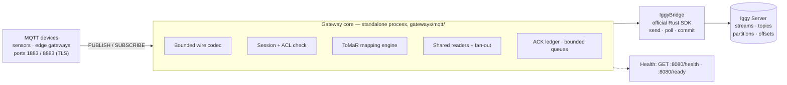
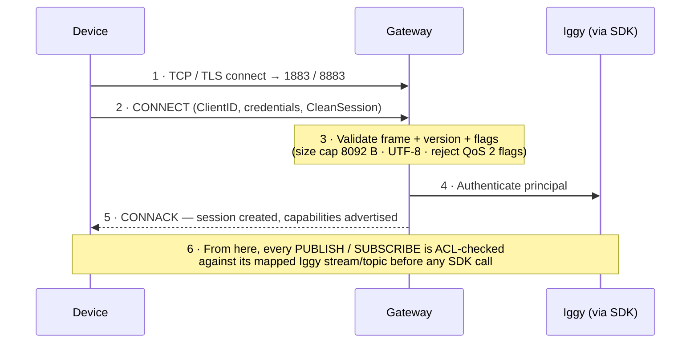
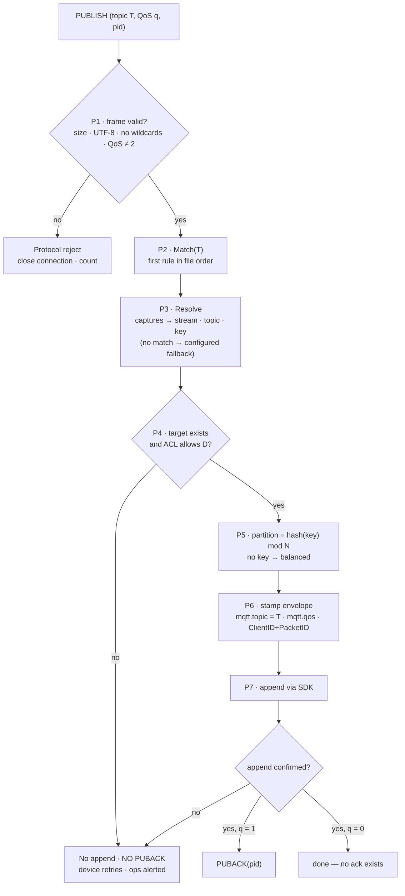
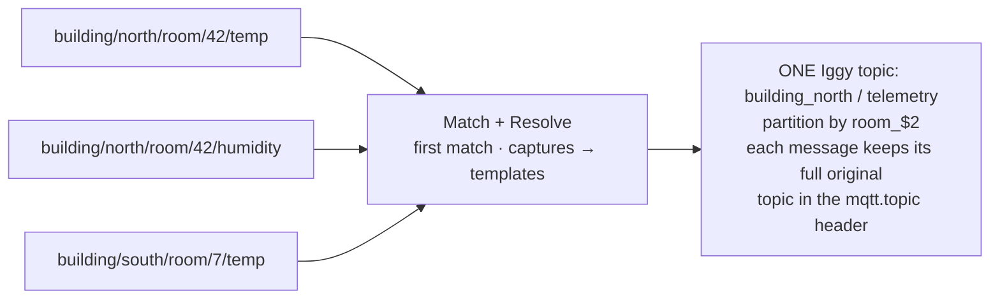
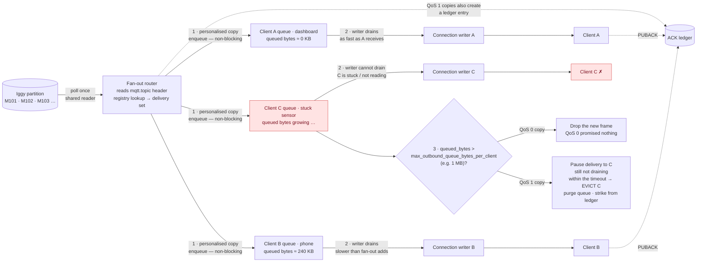
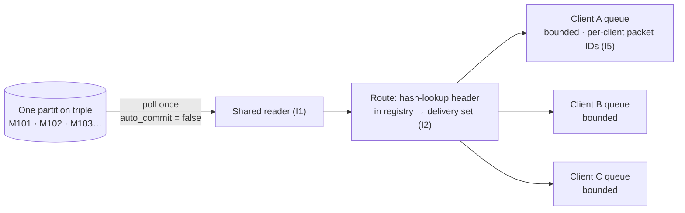
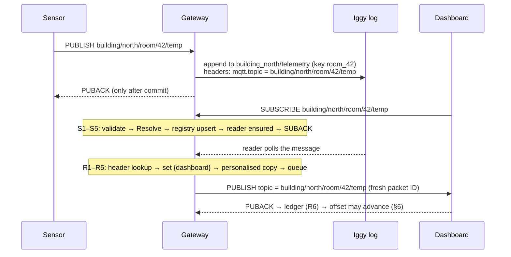

# MQTT Gateway for Apache Iggy 

> A standalone MQTT gateway that lets devices **publish to** and **subscribe from** Iggy,
> without changing Iggy Core.Discussion: [#4201](https://github.com/apache/iggy/discussions/4201).

---

## TL;DR

- **What:** a separate process (`gateways/mqtt/`) that speaks MQTT on one side and uses the
  official Iggy Rust SDK on the other side. Iggy Core is not touched.
- **Why:** Strimzi and Confluent's MQTT bridges are **publish-only**. This gateway supports
  **both directions** — devices can also subscribe and receive messages back.
- **The hard part is topic mapping, in both directions.** MQTT topics are free-form strings
  (thousands of them); Iggy streams/topics are few and pre-provisioned. The produce side
  aggregates many MQTT topics into few Iggy topics; the fetch side must still deliver each
  message to the subscribers of its *original* topic. One stored header makes that possible.
- **Most decisions are inspired** from existing systems (Strimzi, Iggy's own Kafka gateway,
  HiveMQ, EMQX, NATS). Two decisions are new.

---

## 1. Where this fits

There are two ways to connect MQTT devices to Iggy:

| Path | How | Position |
| --- | --- | --- |
| **Broker + Connector** (preferred for production) | A full broker (EMQX, Mosquitto…) terminates MQTT; the Iggy connector moves messages between broker and Iggy. | Full MQTT semantics, broker does the hard parts. |
| **This gateway** (optional, brokerless) | The gateway itself terminates MQTT and translates to Iggy. | No broker to run; smaller feature set by design (see §3). |



**Two state rules:**

- **Durable state lives in Iggy** (messages, original topics, ordering).
- **Ephemeral state lives in gateway memory** (who is subscribed, who acked what) and is
  rebuilt when clients reconnect. Losing it on a gateway crash is safe.

**Layout:** one flat crate at `gateways/mqtt/` (library + thin binary), mirroring the Kafka
gateway, so reviewers who know `gateways/kafka/` already know where everything is.

---

## 2. First connection

Nothing reaches Iggy until a connection passes three gates:



The **CONNACK is a capability firewall**: the gateway advertises only what it implements
(Maximum QoS = 1, Retain Available = 0, Wildcard Subscription Available = 0) — the same
discipline as the Kafka gateway's supported-ranges table.

---

## 3. Scope: 11 of 14 packets

MQTT 3.1.1 defines 14 packet types. This gateway supports **11**:

- **Supported:** CONNECT, CONNACK, PUBLISH, PUBACK, SUBSCRIBE, SUBACK, UNSUBSCRIBE,
  UNSUBACK, PINGREQ, PINGRESP, DISCONNECT.
- **Excluded:** PUBREC, PUBREL, PUBCOMP — the QoS 2 handshake. **There is no QoS 2.**

Excluded features, and what a client observes on the wire:

| Feature | Behaviour |
| --- | --- |
| QoS 2 publish/subscribe | Rejected (CONNACK advertises Max QoS 1; QoS 2 flags fail validation) |
| Retained messages | Not stored; Retain Available = 0 |
| Persistent sessions / offline queues | Clean sessions only |
| Wildcard subscriptions (`+`, `#` in SUBSCRIBE) | Rejected — SUBACK failure `0x80` (MQTT 5 reason `0xA2`) |
| Shared subscriptions, WebSockets | Deferred, not part of this design |

**Why so small?** Every broker feature is stored state: retained messages are a store,
offline queues are a store, QoS 2 is an exchange state machine. Excluding the features
excludes the stores, which is what keeps the gateway small.

---

## 4. Produce mapping (MQTT → Iggy)

> Specified the same way as §5: named operations, exact steps, decided edge cases,
> testable invariants. The produce operation is **Map + Append**: translate the MQTT
> address, stamp the envelope, append to Iggy, ack only after the append is confirmed.

### 4.1 Definitions

| Term | Precise meaning |
| --- | --- |
| **Rule** | One `[[rule]]` block: a regex `mqtt_topic` + templates `stream`, `topic`, optional `partition_key`. Captures are numbered left to right: `$1`, `$2`, … |
| **Match(T)** | The first rule, in file order, whose regex fully matches topic `T`. File order is semantic — a broad rule above a specific one makes the specific one unreachable. |

| **Resolution** | The result of mapping: \`(stream, iggy topic, partition key \\ | none)`. If no rule matches, the resolution is the configured fallback&#32;`(default\_stream, default\_topic, none)\`. |

| **Envelope** | The Iggy message as stored: payload unchanged, plus headers `mqtt.v` (envelope version), `mqtt.topic` (full original MQTT topic), `mqtt.qos`, and the publisher's ClientID + PacketID. |
| **Ack rule** | A QoS 1 PUBACK is sent **iff** the Iggy append returned success. No append confirmation ⇒ no PUBACK ⇒ the device retries. |

### 4.2 Compile time: what the gateway checks before it serves anyone

At startup the gateway compiles the whole topic-map file and **refuses to start** if any
check fails — a broken mapping must never be discovered by a device in production:

| # | Startup check |
| --- | --- |
| C1 | Every regex compiles. |
| C2 | Every `$n` referenced in a template exists as a capture group in that rule's pattern. |
| C3 | Every capture feeding the `stream` or `topic` template is a **single-level** pattern (it cannot match `/`). A slash-capable capture there is a load-time error, not a runtime surprise (§4.6). |
| C4 | `default_stream` and `default_topic` are present (the document is complete, not an overlay). |
| C5 | Templates, after substitution of literal parts, can only produce valid Iggy names (no `/`, within length limits). |

### 4.3 The produce algorithm

On `PUBLISH(topic T, payload, QoS q, packet ID pid)` from device D:

| Step | Action |
| --- | --- |
| P1 | **Validate the frame.** Size ≤ 8,092 B, topic valid UTF-8, **no wildcard characters in a publish topic**, QoS bits ≠ 2. Violation → protocol reject (connection closed), counted. |
| P2 | **Match.** `rule = Match(T)` — rules in file order, first match wins. Patterns are pre-compiled (C1); per-message cost is matching only, and resolutions may be cached per topic string. |
| P3 | **Resolve.** Fill the rule's templates from T's captures → `(stream, topic, key)`. No rule matched → the configured fallback resolution. |
| P4 | **Authorise + existence.** ACL-check D against the **mapped** `(stream, topic)` — never against the raw MQTT string, so a rule cannot route around permissions. Verify the target exists (auto-creation is **off**). Missing or denied → **no append, no PUBACK**, reject counter + log; the device retries and ops sees it. |
| P5 | **Choose the partition.** If a key exists: `partition = hash(key) mod partition_count(topic)` — the same key always lands in the same partition (for a fixed partition count), which is where per-device ordering comes from. No key → balanced distribution; ordering per device is *not* promised. |
| P6 | **Stamp the envelope.** Build the Iggy message: payload as-is; headers `mqtt.v`, **`mqtt.topic`&#32;= T (complete, unmodified)**, `mqtt.qos` = q, publisher ClientID + PacketID. This step is what makes §5 possible: the Iggy address is lossy, the header is not. |
| P7 | **Append, then ack.** Send via the SDK. On confirmed success: if q = 1, reply PUBACK(pid); if q = 0, nothing (QoS 0 has no ack). On failure or timeout: **no PUBACK**, error counted — the device retries, backpressure reaches the edge, and the gateway stores nothing on the side (no disk buffer in v1). |



### 4.4 One packet, step by step

Device publishes **`building/north/room/42/temp`**, QoS 1, packet ID 9, config as in §4.7:

| Step | Result |
| --- | --- |
| P1 | Frame valid. |
| P2 | Rule 1 matches: `building/` literally · `(\w+)` captures `north` → $1 · `/room/` literally · `(\d+)` captures `42` → $2 · `.*` absorbs `temp` (not captured). Rule 2 never evaluated. |
| P3 | Resolution: stream `building_north`, topic `telemetry`, key `room_42`. |
| P4 | `building_north/telemetry` exists; device ACL allows it. |
| P5 | `hash("room_42") mod N` → one fixed partition, same as every other room-42 message. |
| P6 | Envelope headers: `mqtt.topic = building/north/room/42/temp`, `mqtt.qos = 1`, ClientID + PacketID 9. |
| P7 | Append confirmed → **PUBACK(9)**. Only now does the device know the message is durable in Iggy. |

Three more packets against the same config:

| Publish topic | Resolution | Why |
| --- | --- | --- |
| `building/north/room/42/humidity` | `building_north / telemetry / room_42` | Rule 1 — same partition as room 42's temperature. Aggregation working as intended. |
| `sensors/kitchen-1/data` | `sensors / sensor_data / sensor_kitchen-1` | Rule 1 doesn't fit (no `building/` prefix) → rule 2: `([^/]+)` captures `kitchen-1`, dash included. |
| `factory/line3/status` | `sensors / messages_default / (no key)` | No rule matches → configured fallback. Stored and acked; the fallback-hit metric tells ops a new device family arrived. |

### 4.5 The aggregation, in one picture



Thousands of device topics collapse into a handful of Iggy topics. \*\*The collapse is
lossy at the address level and lossless at the message level\*\* — the header carries what
the address dropped.

### 4.6 The only regex an operator needs

| The value in the real topic | Pattern | Notes |
| --- | --- | --- |
| Any one level, characters unknown | `([^/]+)` | The safe default. Matches dashes/dots; never crosses a `/`. (MQTT's `+`.) |
| Simple word (letters/digits/`_`) | `(\w+)` | Refuses `kitchen-1` — the dash breaks it. |
| Pure number (room, bed, device no.) | `(\d+)` | The classic partition key. |
| Number with size limit | `(\d{1,4})` | Strimzi's documented example uses this for room numbers. |
| Fixed word + number | `(line\d+)` | e.g. `line3` → stream template `factory_$1` = `factory_line3`. |
| Everything remaining (the metric tail) | `.*` at the end, **outside** parentheses | MQTT's `#`. **Never captured** (check C3 makes it impossible in stream/topic templates): a captured value can contain `/`, which is invalid in an Iggy name. The tail is not lost — it is in the `mqtt.topic` header. |

Rules of thumb:

- **Captures come only from single-level patterns**, so a captured value can never
  contain `/`, so any name built from it is automatically valid.
- **Bounded variation goes into stream/topic names** (buildings are few and
  pre-provisioned); **unbounded variation goes into the partition key and the header**
  (rooms are many, but they only select a lane inside an existing topic).
- Real topic spaces are firmware-defined *families*: 10 buildings × 200 rooms × 3 metrics
  is 6,000 topics but **one family, one rule**. Rule count tracks device types, not devices.

### 4.7 The config, annotated

```toml
# topic-map.toml — one complete document (check C4)
default_stream = "sensors"            # fallback resolution, part 1
default_topic  = "messages_default"   # fallback resolution, part 2 (name is Strimzi's)

[[rule]]   # rule 1 — evaluated first (Match = first match in file order)
mqtt_topic    = 'building/(\w+)/room/(\d+)/.*'   # $1 = building word, $2 = room number
stream        = 'building_$1'                    # one stream per building (bounded set)
topic         = 'telemetry'                      # constant: all metrics aggregate here
partition_key = 'room_$2'                        # stable identity ⇒ ordering per room

[[rule]]   # rule 2
mqtt_topic    = 'sensors/([^/]+)/data'           # $1 = any single level, dashes allowed
stream        = 'sensors'
topic         = 'sensor_data'
partition_key = 'sensor_$1'
```

Use TOML single-quoted (literal) strings for patterns, so regex backslashes need no
doubling. The file is loaded via gateway config (same env pattern as the Kafka gateway's
`IGGY_KAFKA_*`), identical on every gateway instance, kept in version control.

### 4.8 Outcomes: every publish ends in exactly one visible state

| # | Outcome | Append? | PUBACK? | Signal |
| --- | --- | --- | --- | --- |
| O1 | Rule matched, target exists, ACL ok, append confirmed | ✅ | ✅ (QoS 1) | — |
| O2 | Rule matched, target missing or ACL denied | ❌ | ❌ — device retries | Reject counter + log |
| O3 | No rule matched → configured fallback | ✅ | ✅ (QoS 1) | Fallback-hit metric |
| O4 | Malformed frame (P1 failure) | ❌ | ❌ — protocol reject, connection closed | Counted |
| O5 | Append failed / Iggy unreachable | ❌ (not confirmed) | ❌ — device retries | Error counter; backpressure reaches devices |

There is no sixth outcome and no silent path — that totality is what "coverage" means for
the produce side.

### 4.9 Edge cases, decided

| Case | Behaviour |
| --- | --- |
| Device retries after a lost PUBACK (append actually succeeded) | The retry **appends a duplicate**. This is at-least-once, stated plainly: the gateway does not dedup in v1. The stored ClientID + PacketID headers let a downstream consumer dedup if it needs to. |
| Same device, same key, high rate | All messages hash to one partition → strict order for that key; partition count is the parallelism ceiling for that key. Choose partition counts generously at provisioning; changing the count later re-shuffles key → partition assignment. |
| Publish topic contains `+` or `#` | P1 protocol violation → connection closed (MQTT forbids wildcards in publish topic names). |
| Topic that matches a rule whose stream was never provisioned | P4 failure → O2. Loud by design: provisioning is a deliberate act, auto-creation is off. |
| Iggy outage mid-traffic | O5 for every publish: no PUBACKs, devices hold and retry. The gateway accumulates nothing; when Iggy returns, retries drain naturally. |
| Payload content | Opaque bytes. The gateway never parses, transforms, or inspects payloads. |

### 4.10 Invariants (testable)

1. **J1 — Determinism.** Same topic + same config ⇒ same resolution, always. (Match is a pure function.)
2. **J2 — PUBACK ⇒ persisted.** A QoS 1 PUBACK is sent only after the SDK confirmed the append. PUBACK means "durable in Iggy", never "received by the gateway".
3. **J3 — No silent loss.** Every publish ends in exactly one outcome O1–O5; O2/O4/O5 are all counted and logged.
4. **J4 — Header completeness.** Every gateway-appended message carries `mqtt.topic` with the complete original topic. §5's correctness rests on this.
5. **J5 — Key stability.** For a fixed partition count, the same partition key always resolves to the same partition.
6. **J6 — Authorisation target.** ACLs are evaluated only against mapped targets, never raw MQTT strings.

---

## 5. Fetch mapping (Iggy → MQTT subscribers)

> **This section is the original part of the design.** Strimzi and Confluent are
> publish-only, so no existing system defines fetch mapping. It is specified here as two
> named operations — **Resolve** (at subscribe time) and **Route** (at delivery time) —
> with exact inputs, outputs, and invariants, so it can be reviewed like code.

### 5.1 Definitions

| Term | Precise meaning |
| --- | --- |
| **Registry** | In-memory map: `exact MQTT topic → set of subscribers`. A subscriber record is `{client, granted QoS, outbound-queue handle}`. Nothing about subscriptions is stored in Iggy. |
| **Reverse index** | In-memory map: `client → set of topics it appears in`. Exists so disconnect/eviction cleanup is O(subscriptions of that client). |
| **Partition identity** | The triple `(stream, iggy topic, partition id)`. Readers and offsets are per triple, never per stream alone. |
| **Resolve(topic)** | The function that answers: *"if a message with this exact MQTT topic is published, which partition triple(s) will it land in?"* |
| **Delivery set** | For one polled message: the snapshot of `registry[header topic]` taken at poll time (§5.4, step R3). |

### 5.2 Resolve: how a subscription finds its partition

Key insight: a subscription topic is a \*\*concrete string of exactly the same form a
publisher would use\*\*. So Resolve does not need a second, inverse rule system — it runs
the *same* ToMaR evaluation as the produce side (§4), forward, on the subscribed string:

```text
Resolve(T):
  rule        = first rule matching T            (same first-match order as produce)
  (s, t, key) = rule's templates filled from T's captures
                — or the configured default stream/topic if no rule matches
  if the rule has a partition_key:
      return { (s, t, hash(key) mod partition_count(t)) }        // exactly one triple
  else:
      return { (s, t, p) for every partition p of t }             // no key ⇒ any partition
```

Consequences, stated explicitly:

- A normal (keyed) subscription resolves to **exactly one** partition triple.
- An unkeyed rule means messages were spread across partitions at publish time, so the
  subscription must attach to **all** of that Iggy topic's partitions. This is the price
  of not naming a key, and it is paid by the reader count, not by correctness.
- Resolve is deterministic and side-effect-free: same topic + same config ⇒ same triples,
  at subscribe time and forever after (until the config changes).

### 5.3 Subscribe-time algorithm

On `SUBSCRIBE(topic T, requested QoS q)` from client C:

| Step | Action |
| --- | --- |
| S1 | **Validate.** T must be an exact topic: no `+`/`#`, valid UTF-8, within size limits. Failure → SUBACK `0x80`. |
| S2 | **Resolve.** Compute `Resolve(T)` (§5.2). ACL-check C against the resolved Iggy target. Denied → SUBACK `0x80`. |
| S3 | **Upsert the registry entry.** `registry[T].insert({C, min(q, 1), C's queue handle})`; `reverse_index[C].insert(T)`. If C was already in the set, its record is **replaced**, never duplicated (re-subscribe updates QoS). |
| S4 | **Ensure readers.** For each resolved triple: increment its refcount; on a `0 → 1` transition, spawn the shared reader for that triple, starting from the gateway's stored consumer offset for it. |
| S5 | **Reply.** SUBACK with granted QoS = `min(q, 1)`. The subscription is live from the **next poll** of each resolved partition (§5.5). |

On `UNSUBSCRIBE(T)` / disconnect / eviction, the mirror image: remove C from
`registry[T]` (delete the key if the set empties), remove T from `reverse_index[C]`,
decrement each resolved triple's refcount, and stop a reader whose refcount reaches 0
(after its ledger has no pending entries — §6).

### 5.4 Delivery-time algorithm (Route)

The shared reader for a triple polls a batch with `auto_commit = false`. For each
message M, in partition order:

| Step | Action |
| --- | --- |
| R1 | **Read the header.** Let `H = M.headers["mqtt.topic"]`. If absent, M is a native Iggy message: it leaves the registry path entirely (§5.6). Its delivery set is empty, so it never blocks the offset. |
| R2 | **Look up.** `S = registry[H]` — one hash lookup. No regex, no wildcard matching at delivery time, ever. |
| R3 | **Snapshot.** M's delivery set = QoS 1 members of S, copied at this instant. Later subscribes/unsubscribes do not change it. |
| R4 | **Fan out.** For **every** member of S: build a personalised copy — topic = `H`, payload = M's payload (shared bytes, not copied), QoS = `min(member's granted QoS, M's QoS)`. QoS 1 members additionally get a packet ID from *their own* per-client counter and a ledger entry `(triple, M.offset, client → packet ID)`. QoS 0 members get a best-effort copy and **no** ledger entry. |
| R5 | **Enqueue, never block.** Each copy goes into that client's bounded outbound queue (non-blocking). Queue full → slow-consumer policy (§6.5). The reader proceeds to the next message regardless of any client's state. |
| R6 | **On PUBACK(client, packet ID):** find the ledger entry, mark that client acked for that offset, then advance the stored consumer offset to the highest **contiguous** fully-acked prefix (§6.2). |


### 5.5 Worked example

Registry state and one polled batch from triple `(building_north, telemetry, P3)`:

```text
registry:
  building/north/room/42/temp      → { dashboard (QoS 1), phone (QoS 1) }
  building/north/room/42/humidity  → { dashboard (QoS 1) }
  building/south/room/7/temp       → { tablet (QoS 0) }

polled:  M101 header …/room/42/temp      → set {dashboard, phone} → 2 copies, 2 ledger entries
         M102 header …/room/42/humidity  → set {dashboard}        → 1 copy,  1 ledger entry
         M103 header …/room/9/co2        → set { }                 → 0 copies, blocks nothing
         M104 header …/room/7/temp      → set {tablet (QoS 0)}    → 1 best-effort copy, NO ledger entry
```

Timing, pinned down: if the phone subscribes to `…/room/42/humidity` *after* M102 was
polled, the phone is **not** added to M102's set (R3 snapshot) — it starts receiving from
the next poll onward.

### 5.6 Edge cases, decided

| Case | Behaviour |
| --- | --- |
| Client subscribes twice to the same topic | Upsert (S3): one record, latest QoS. Never two copies. |
| Two of a client's topics resolve to the same triple | Two registry entries, one reader. Routing is per message header only — a message is delivered once per *matching entry*, and a client cannot match one message through two entries (headers are single exact topics). |
| Disconnect with acks outstanding | Removal via the reverse index also strikes the client from all pending delivery sets — a clean-session client that is gone cannot hold the offset (same ledger effect as eviction, §6.3). |
| Empty delivery set / QoS 0-only set | Never blocks the contiguous prefix (R3/R4). The message remains in the log for non-MQTT consumers. |
| Native Iggy message (no `mqtt.topic` header) | Not routable via the registry. Delivered only if an explicit outbound rule names an MQTT topic for its Iggy topic; otherwise skipped for MQTT clients. Never blocks the offset. |
| Config change while running | Out of scope for v1: new config applies on restart; Resolve results are not migrated mid-flight. |

### 5.7 Invariants (testable)

1. **I1 — Single reader.** At most one reader task exists per partition triple at any time.
2. **I2 — Exact delivery.** A client receives M **iff** it was in `registry[M.header topic]`
   at M's poll instant.
3. **I3 — No skipped acks.** The stored offset for a triple never advances past a message
   with a pending QoS 1 ledger entry, except by removing that client from the set
   (disconnect/eviction, §6.3).
4. **I4 — Per-client order.** Copies enter each client's queue in partition order; a
   client's messages are never reordered by fan-out.
5. **I5 — Packet ID uniqueness.** A packet ID is unique among a client's inflight
   (unacked) messages, so a PUBACK identifies exactly one ledger entry.



### 5.8 The round trip, end to end



**One line:** \*aggregation on the way in is lossy; reconstruction on the way out is exact —
because the original address travelled in the header.\*

---

## 6. How the two sides bind: POLL ≠ ACK

### 6.1 Inbound rule

> **A PUBACK is sent only after Iggy confirms the message is persisted.**
> PUBACK means "durable in the log" — the same rule NATS uses for its MQTT QoS 1
> (store, then ack). If Iggy is down, the gateway simply does not ack, and QoS 1 devices
> retry — backpressure reaches the edge instead of data being lost in the gateway.

### 6.2 Outbound rule

Polling a message is **not** delivering it. The gateway calls
`store_consumer_offset()` only up to the **highest contiguous prefix** of messages whose
*entire delivery set* has returned PUBACK:

```text
Ledger:   M101 → A ✓  B ✓  C ✗ pending      committed offset: M100
          M102 → A ✓  B ✗  C ✗ pending
```

- Acks may arrive out of order — M102 and M103 fully acked while M101 is not — and the
  offset **still** cannot pass M101: skipping it would silently lose a QoS 1 message,
  because the sequential cursor will never re-read it.
- The honest guarantee: \*\*delivered to, and acknowledged by, every responsive subscriber
  in the delivery set.*\* (PUBACK proves the client's MQTT \*stack* received the message,
  not that its application processed it durably.)

### 6.3 A stall, and its resolution

One silent client (C, above) freezes the partition's offset. The design answers in three
steps:

1. **Identify.** C is stalled if no PUBACK arrives within `idle_timeout_seconds`, or C's
   queued bytes exceed `max_outbound_queue_bytes_per_client`.
2. **Bound the damage.** Each partition has a **bounded unacked window**: at the cap, the
   reader pauses polling that partition. A stall becomes backpressure, not a memory leak.
   Other partitions are unaffected.
3. **Evict.** On timeout: close C's socket, purge its queue, remove it from the registry
   and from all pending delivery sets. Now M101's set is {A, B} — both acked — so the
   offset advances to **M101, exactly**. M102 still waits on B. Eviction never forges
   anyone else's ack.

### 6.4 Four rules that keep the ledger sound

1. **QoS 0 subscribers never enter a blocking delivery set** — they send no PUBACK, so one
   QoS 0 client would deadlock the partition. They get a best-effort copy only.
2. **An empty delivery set blocks nothing** — a message nobody subscribed to (by exact
   topic) may be passed by the offset. It stays in the log.
3. **Delivery sets are fixed at poll time** — a client subscribing later joins from the
   next poll onward, never retroactively.
4. **Eviction is a stated exception, not a silent one** — no loss for subscribers that stay
   connected and responsive; a client that cannot keep up is sacrificed for group progress
   and may miss messages (including ones the group committed past while it was away).
   Shared partition ⇒ shared fate: a stalled subscriber to one topic can hold up commits
   for other topics interleaved in the same partition.

### 6.5 Slow-consumer policy, per QoS

| Client's queue fills up | QoS 0 | QoS 1 |
| --- | --- | --- |
| Behaviour | **Drop the frame immediately** | Pause delivery to that socket; if it doesn't drain within the thresholds, **evict** (§6.3) |
| Why | QoS 0 promised nothing — loss is legal; dropping protects gateway memory | QoS 1 promised at-least-once — wait a bounded time, then sacrifice that one client instead of strangling the partition |

---

## 7. Limits and health

All limits live in one `GatewayLimits` config struct. The numbers below are \*\*proposed
starting defaults to be tuned by benchmarks — not guarantees\*\*:

| Limit | Default |
| --- | --- |
| Max connections | 10,000 |
| Subscriptions per client | 50 |
| Max packet size | 8,092 B |
| Inflight messages per client | 100 |
| Outbound queue per client | 1 MB |
| Shared readers | 100 |
| Idle timeout | 60 s |

Plus a **global** outbound-queue byte cap, so per-client limits can't multiply into an
unbounded total. Health endpoints: `GET :8080/health` and `GET :8080/ready`
(ready = SDK connected to Iggy).

---

## 8. Where each decision comes from

Inspired, not invented — unless §9 says otherwise:

| Decision | Source |
| --- | --- |
| ToMaR name, regex + `$n` substitution, first-match-wins, `messages_default` fallback, separate mapping file, 8,092 B cap | **Strimzi** MQTT Bridge (Confluent independently uses the same 8,092 B) |
| TOML mapping file as a complete document with a required default | Iggy **Kafka gateway** |
| Crate layout, config style, capability table as single source of truth, stubs never fake success, bounded timeouts/retries on SDK calls | Iggy **Kafka gateway** |
| PUBACK only after the message is stored | **NATS** (MQTT QoS 1 over JetStream) |
| At-least-once as the honest ceiling; no exactly-once claims | Consensus across all surveyed systems |
| Publish-only scope discipline (what a constrained proxy should *not* grow into) | **Confluent** MQTT Proxy (deprecated in CP 7.9 — replacement guidance is broker + connectors, which is also §1's preferred path) |

Deliberately **not** copied: the Kafka gateway's ACL gap (auth treated as a view, not
enforcement) — here, ACLs are enforced against the mapped target before any SDK call.

## 9. What is genuinely new

Two decisions have **no precedent** in any surveyed system. They are new because the
problem is new: the publish-only bridges never move a shared cursor on behalf of many
subscribers.

1. **The outbound offset advances only through contiguous client PUBACKs** (§6.2).
   HiveMQ commits per processed batch and EMQX on a timer — both can pass messages a
   client never acked — because neither shares one sequential cursor across subscribers.
   Given one shared reader (§5.2) plus QoS 1, the contiguous rule is arguably *forced*:
   anything weaker silently loses messages.
2. **One shared reader per partition with local fan-out** (§5.2). Its benefit is Iggy-side:
   one poll stream and one offset per partition instead of one per client. (Fan-out still
   writes one copy per client — the saving is reads and bookkeeping, not egress.)


## 12. Auth model implementation: shared Iggy identity + gateway-side ACLs

This section makes §10.1 concrete. The model has one sentence:

> \*\*Devices authenticate to the gateway. The gateway authenticates to Iggy as one
> least-privilege service user. Iggy never sees devices; the gateway enforces every
> per-device rule itself, and proves it did so through headers and audit logs.\*\*

### 12.1 The two identities

| Identity | Lives where | Used for |
| --- | --- | --- |
| **Device principal** (thousands) | Gateway only — a principals file/config, never an Iggy user | CONNECT authentication, per-device ACL checks, audit attribution |
| **Service identity** (exactly one) | Iggy — e.g. user `iggy_mqtt_gateway` | Every SDK call the gateway makes: append, poll, store offsets |

Why not one Iggy user per device (the Kafka gateway's model)? Device fleets are large,
churn often, and already carry MQTT credentials; mirroring them into Iggy's user store
couples fleet provisioning to Iggy administration. The cost of the shared model is equally
clear: **the gateway becomes a trusted, privileged component**, and §12.6 states what that
costs. Both models are defensible; this section exists so the choice is made with the
implementation bill visible.

### 12.2 Iggy-side implementation (provisioning)

1. Create the service user with **least privilege**: produce + poll + commit-offsets on
   *gateway-managed streams/topics only*. No admin rights, no global permissions, no
   access to unrelated streams.
2. The gateway holds its credential the Kafka-gateway way: environment config
   (`IGGY_MQTT_IGGY_USERNAME` / `IGGY_MQTT_IGGY_PASSWORD`), \*\*required, no default,
   fail-fast refusal to start\*\* if absent.
3. One authenticated SDK client inside `IggyBridge`, established at startup; `/ready`
   reports "not ready" until that login succeeds.
4. Consumer offsets for the shared readers (§5) are stored under this identity, in a
   gateway-owned consumer group (e.g. `mqtt_gateway`) — offsets belong to the gateway,
   never to devices.
5. Rotation = replace the env credential and restart/re-login the gateway. Device
   credentials are unaffected by service rotation, and vice versa.

### 12.3 Device-side implementation (principals)

A principal record is small and file-based in v1 (same operational pattern as the
topic-map file — version-controlled, loaded and validated at startup):

```toml
# principals.toml
[[principal]]
username       = "building-north-gateway"   # MQTT username presented at CONNECT
password_hash  = "argon2id:…"               # hash only — never plaintext (§12.4)
client_id_rule = "prefix:building-north-"   # which ClientIDs this principal may use
group          = "building-sensors"
```

Two mechanisms are supported, in order of preference:

- **mTLS client certificates** (port 8883): the principal is the certificate's CN/SAN;
  no password exists anywhere. Preferred for managed fleets.
- **Username + password** (TLS required; plaintext listeners refuse password auth):
  the password is verified against the stored hash.

The `client_id_rule` matters: authentication proves *who connected*, but MQTT lets a
client claim any ClientID. Binding ClientIDs to the principal (exact or prefix match)
stops one authenticated device from impersonating another device's identity in headers,
wills, and audit trails.

### 12.4 The CONNECT authentication pipeline (implementation of Gate 2, §2)

| Step | Action |
| --- | --- |
| A1 | Extract identity: certificate CN/SAN (mTLS) **or** CONNECT username. Bind-check the presented ClientID against `client_id_rule`; mismatch → refuse. |
| A2 | Look up the principal. Unknown principal and wrong password produce the **same** refusal (CONNACK `0x05` / MQTT 5 `0x87`) — no oracle for which half failed. |
| A3 | Verify the password against the stored **Argon2id** hash with a constant-time comparison (the same hashing family Iggy itself uses). |
| A4 | Throttle failures per source and per principal (backoff + counter + audit event), so the gate cannot be brute-forced at wire speed. |
| A5 | On success, attach an immutable **session principal context** `{principal, group}` to the connection. Every later check (§12.5) reads this context — credentials are never re-sent or re-checked per packet. |

### 12.5 The ACL implementation (where the checks actually run)

An ACL entry is `{principal or group, operation, target, effect}` with **default deny**
and **first match wins** (same evaluation style as ToMaR). Targets are \*\*mapped Iggy
targets\*\*, never raw MQTT strings (invariant J6):

```toml
[[acl]]
group     = "building-sensors"
operation = "publish"            # or "subscribe"
stream    = "building_*"         # mapped-target scope
topic     = "telemetry"
effect    = "allow"
```

Evaluation points — exactly two, both already in the algorithms above:

| Where | When | What is checked |
| --- | --- | --- |
| Produce step **P4** (§4.3) | Every PUBLISH, after Resolve | `(session principal, publish, resolved stream/topic)` |
| Fetch step **S2** (§5.3) | Every SUBSCRIBE, after Resolve | `(session principal, subscribe, resolved stream/topic)` |

Implementation notes: ACL rules are compiled at startup alongside the topic map
(broken ACL file ⇒ gateway refuses to start, same discipline as C1–C5); evaluation is a
compiled in-memory scan, first match, default deny; a deny is an O2 outcome on the
produce side (§4.8) and SUBACK `0x80` on the fetch side — always counted and audit-logged.
This is enforcement on the data plane from day one — deliberately *not* the Kafka
gateway's documented "ACL as a view, not enforcement" position.

### 12.6 Attribution: how anyone can tell devices apart afterwards

With a shared identity, Iggy's own logs show only `iggy_mqtt_gateway`. Per-device
attribution is therefore the gateway's job, in two places:

1. **In the data:** the envelope (§4.1, step P6) stamps the publisher's principal and
   ClientID into message headers — any consumer reading the log can see which device
   produced a message.
2. **In the audit log:** structured gateway-side events for auth success/failure, ACL
   denies, subscribe/unsubscribe, and evictions — each with \`{timestamp, principal,
   ClientID, operation, raw topic, mapped target, outcome}\`. The audit log is the
   compensating control for the shared identity; without it, this model should not ship.

### 12.7 Honest costs of this model (stated, not hidden)

| Cost | Mitigation in this design |
| --- | --- |
| Gateway compromise ⇒ access to everything the service user can reach | Least-privilege scoping (§12.2.1) caps the blast radius to gateway-managed topics |
| A gateway ACL bug is an authorisation bug Iggy cannot catch | ACL evaluator is small, compiled, default-deny, and covered by golden tests; denies are logged |
| Iggy cannot rate-limit or ban a single abusive device | The gateway can: per-principal throttles (A4) and instant gateway-side revocation (delete the principal; no Iggy change needed) |
| Service credential rotation touches the whole gateway | Rotation is one env change + restart; devices are unaffected (§12.2.5) |

## 13. Build plan

Following the Kafka gateway's route (Discussion → foundation issue → batch-filed
sub-issues → maintainer-created umbrella, like #3560):

- **Foundation first:** crate scaffold, config (`IGGY_MQTT_*`), `GatewayLimits`, capability
  table, design doc beside the code.
- **Then parallel tracks:** wire codec + golden fixtures · ToMaR (produce + fetch sides) ·
  IggyBridge + message envelope · auth pipeline (per §10.1 ruling).
- **Then integration, in slices:** inbound publish path → subscription registry + shared
  reader → fan-out + ACK ledger + eviction (its own PR) → TLS + health + metrics →
  end-to-end tests with real MQTT clients + benchmarks + docs.
- **PR discipline:** soft limit **3k LoC**, hard limit **5k LoC** per PR; direct-to-master
  in slices (the crate is a leaf behind an opt-in binary); sub-issues written so several
  people can pick them up in parallel.

Phasing inside the design: **Phase 1** inbound publish path; **Phase 2** subscription
engine (registry, shared reader, fan-out, ledger); **Phase 3** cluster coordination and
published benchmarks (capacities stated from measurements, never as guarantees).
